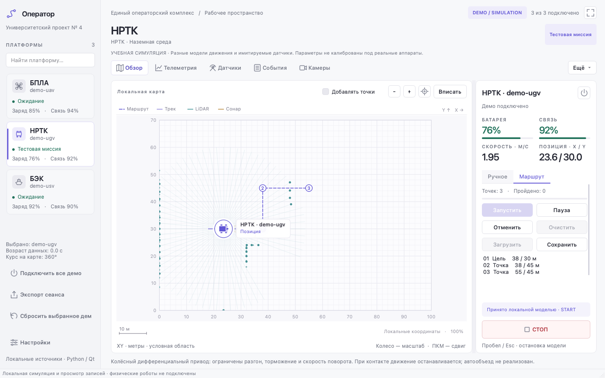

# Единый операторский комплекс — Python desktop 0.4

[](https://github.com/Hazernit/operator-complex-python/actions/workflows/tests.yml)


**Учебный прототип единого рабочего места оператора БПЛА (UAV), наземных роботов/НРТК (UGV) и безэкипажных катеров (USV/БЭК)**. Написан на Python и PySide6. Нужен для разработки UI, команд, телеметрии, маршрутов и сценариев до подключения реальных платформ.

> **Сейчас:** локальное desktop-приложение с учебной симуляцией, демонстрационными датчиками и чтением записей. Реального управления оборудованием, FastAPI/backend, ROS 2, Gazebo, PostgreSQL и видеопровайдера **пока нет в `main`** — это следующие этапы командного проекта.
>
> **Безопасность:** кнопка **СТОП** останавливает локальную модель; это не аппаратная аварийная остановка физического робота.



[Карта и датчики](docs/screenshots/sensors.png) · [Телеметрия](docs/screenshots/telemetry.png) · [Подробное руководство](docs/PROTOTYPE_GUIDE.md) · [Задачи проекта](https://github.com/Hazernit/operator-complex-python/issues)

## Скачать приложение — две бета-версии

**Обе редакции уже опубликованы** в [GitHub Releases](https://github.com/Hazernit/operator-complex-python/releases) и доступны независимо друг от друга. **Technical 0.3** сохраняет техническое представление, **New Interface 0.4** предлагает новый рабочий интерфейс. Пока это **два отдельных направления**, а не замена старой функциональности новым дизайном.

| Редакция | Windows 10/11 x64 | macOS Apple Silicon |
| --- | --- | --- |
| **Technical 0.3 — Beta 1** | [Скачать EXE + BAT в ZIP](https://github.com/Hazernit/operator-complex-python/releases/download/v0.3.0-beta.1/OperatorComplex-v0.3.0-beta.1-Windows-x64.zip) | [Скачать APP в ZIP](https://github.com/Hazernit/operator-complex-python/releases/download/v0.3.0-beta.1/OperatorComplex-v0.3.0-beta.1-macOS-arm64.zip) |
| **New Interface 0.4 — Beta 1** | [Скачать EXE + BAT в ZIP](https://github.com/Hazernit/operator-complex-python/releases/download/v0.4.0-beta.1/OperatorComplex-v0.4.0-beta.1-Windows-x64.zip) | [Скачать APP в ZIP](https://github.com/Hazernit/operator-complex-python/releases/download/v0.4.0-beta.1/OperatorComplex-v0.4.0-beta.1-macOS-arm64.zip) |

На **Windows** полностью распакуйте ZIP и запускайте `OperatorComplex.exe` / `Start-OperatorComplex.bat` для Technical либо `OperatorComplexNewInterface.exe` / `Start-OperatorComplexNewInterface.bat` для New Interface. Не переносите EXE отдельно от остальных файлов. На **Mac с Apple Silicon** (macOS 14.4+) распакуйте ZIP и откройте `OperatorComplex.app` либо `OperatorComplexNewInterface.app`. **Python отдельно устанавливать не нужно.** Для Intel Mac готового пакета пока нет.

Для каждой версии есть [страница релиза Technical](https://github.com/Hazernit/operator-complex-python/releases/tag/v0.3.0-beta.1) и [страница релиза New Interface](https://github.com/Hazernit/operator-complex-python/releases/tag/v0.4.0-beta.1) с `SHA256SUMS.txt`. Не путайте архивы приложений в **Assets** с автоматически созданными архивами **Source code**, содержащими только исходники.

**Ограничения беты:** исходные Windows ZIP Beta 1 пока не прошли отдельный подтверждённый запуск на пользовательском Windows-компьютере (будущие сборки проверяются в Windows CI); macOS-пакеты не нотариализованы Apple. Возможны предупреждения SmartScreen/Gatekeeper. Оба приложения используют **демонстрационные данные**, а не управляют физическими роботами.

### Как собрать и опубликовать следующую бету через GitHub Actions

1. **Сначала внесите изменения** и проверьте их через Pull Request: `develop/technical` — исходники Technical 0.3; `main` — исходники New Interface 0.4. Убедитесь, что нужные изменения уже в соответствующей ветке.
2. Откройте [**Actions → Desktop beta packages**](https://github.com/Hazernit/operator-complex-python/actions/workflows/desktop-betas.yml), нажмите **Run workflow** и оставьте ветку запуска workflow **`main`** (там лежат инструменты сборки). Исходники нужной редакции workflow заберёт автоматически.
3. Выберите **`edition`** и укажите **новый, ещё не существующий `tag`**:

   | Редакция | edition | Пример следующего тега | Откуда собирается |
   | --- | --- | --- | --- |
   | Technical | `technical` | `v0.3.0-beta.2` | `develop/technical` |
   | New Interface | `new-interface` | `v0.4.0-beta.2` | `main` |

4. Нажмите **Run workflow**. GitHub соберёт приложения на **Windows x64 и macOS Apple Silicon**, проверит ресурсы и GUI-запуск готовых `.exe`/`.bat`/`.app` и создаст архивы. **Только после успешной проверки обеих ОС** будет опубликован новый **Pre-release** с ZIP и `SHA256SUMS.txt`.
5. Перейдите в [**Releases**](https://github.com/Hazernit/operator-complex-python/releases), откройте выпуск с новым тегом и проверьте наличие **двух ZIP** (Windows и macOS) и контрольных сумм. Предыдущие версии остаются доступными; **повторно использовать тег Beta 1 или перезаписывать старый Release нельзя**.

**Нужно только протестировать сборку без публикации?** Изменения в инструментах упаковки проверяются в Pull Request: workflow собирает обе редакции и сохраняет проверенные ZIP как временные **Actions artifacts**, но **не создаёт Release**. Ручная команда **Run workflow**, напротив, предназначена для **выпуска новой беты**.

**Обновление приложения:** при появлении новой беты пользователь пока скачивает свежий ZIP из Releases и заменяет прежнюю версию вручную. **Встроенного автообновления нет.** Подробности и ограничения: [инструкция по релизам](docs/RELEASES.md) и [документация сборок](docs/BETA_RELEASES.md).

## Что реализовано, а что ещё нет

| Возможность | Состояние в `main` | Что важно знать |
| --- | --- | --- |
| Окно оператора на PySide6 | ✅ Прототип | Список платформ, поиск, карточки и общие органы управления |
| БПЛА, НРТК и БЭК | ✅ Локальные модели | Независимая симуляция, **на карте видна одна выбранная** платформа, не три сразу |
| Ручное управление / WASD / маршруты | ✅ В симуляции | Инерция моделей, запуск, пауза, продолжение и отмена маршрута |
| LiDAR, сонар, эхолот | ✅ Демонстрационные данные | Синтетические показания, не измерения реального оборудования |
| Импорт TXT/CSV | ✅ | Воспроизведение записи без отправки команд роботу |
| Предупреждения и offline/stale | ✅ Для локальной модели | Нет аппаратного подтверждения состояния |
| Windows/macOS-запускатели | ✅ Исходники | `.bat` добавлены из 0.3; реальные сценарии установки на Windows ещё требуют проверки |
| FastAPI, БД, WebSocket/live-флот | ⏳ В разработке | Отдельные направления команды, см. [Issues](https://github.com/Hazernit/operator-complex-python/issues) |
| ROS 2 / Gazebo / реальные платформы / видео | ⏳ Не подключены | Этапы интеграции, не готовые функции |

## Быстрый запуск из исходников

Если нужно **просто открыть готовое приложение**, скачайте ZIP своей редакции и ОС в [разделе бета-сборок](#скачать-приложение--две-бета-версии): там уже есть EXE/APP, устанавливать Python не требуется.

Ниже описан **запуск именно из исходного кода** (текущая ветка `main` — New Interface 0.4; техническая редакция развивается отдельно в [`develop/technical`](https://github.com/Hazernit/operator-complex-python/tree/develop/technical)). Сначала склонируйте проект:

```bash
git clone https://github.com/Hazernit/operator-complex-python.git
cd operator-complex-python
```

HTTPS подходит для публичного чтения без настройки SSH. Если проект уже склонирован, зайдите в его корневую папку — повторно клонировать не нужно.

### Способ 1 — запускатели проекта (рекомендуется)

| ОС | Запускатель | Как запустить | Подготовка Python |
| --- | --- | --- | --- |
| **Windows 10/11, 64-bit** | [`run-windows.bat`](run-windows.bat) — специализированный; [`run-python-project.bat`](run-python-project.bat) — универсальный | Дважды щёлкните BAT в корне исходников или выполните команду ниже | Может найти или скачать подходящий Python, создать `.venv` и установить зависимости |
| **macOS** | [`run.command`](run.command) | Двойной щелчок или `sh run.command` | Требуется установленный `python3`; `bootstrap.py` подбирает Python ≥3.11, создаёт `.venv` и ставит зависимости |
| **Linux** | Отдельный `run-linux.sh` **в разработке** ([Issue #20](https://github.com/Hazernit/operator-complex-python/issues/20)) | Пока используйте **`python3 bootstrap.py`** из корня проекта | Требуется установленный Python ≥3.11 и необходимые системные библиотеки Qt |

**Windows — специализированный запускатель** (CMD или PowerShell, в корне проекта):

```powershell
.\run-windows.bat
```

**Windows — универсальный запускатель** (альтернатива, не нужно запускать оба файла):

```powershell
.\run-python-project.bat
```

Универсальный BAT определяет зависимости и доступные точки входа Python-проекта. Если появится меню, для этого приложения выберите **`main.py`**. Подробности: [устройство универсального запускателя](docs/universal-launcher.md).

**macOS — штатный запускатель:**

```bash
sh run.command
```

Его можно открыть и двойным щелчком по `run.command`. Скрипт вызывает `bootstrap.py`; альтернативный способ запустить тот же процесс:

```bash
python3 bootstrap.py
```

При необходимости путь к Python задаётся переменной `OPERATOR_PYTHON`, например `OPERATOR_PYTHON=python3.12 sh run.command`. **`run.command` проверяет наличие команды `python3`,** поэтому на macOS она должна быть доступна в PATH.

**Linux — существующий способ до появления отдельного запускателя:**

```bash
python3 bootstrap.py
```

Этот сценарий использует уже существующий кроссплатформенный `bootstrap.py`: он подготавливает локальное окружение и запускает `main.py`, но **не устанавливает сам Python или системные библиотеки Qt**. Отдельный проверенный Linux-скрипт находится в [задаче #20](https://github.com/Hazernit/operator-complex-python/issues/20).

При первом запуске из исходников обычно нужен интернет для установки Python-зависимостей. Окружение `.venv` создаётся **на каждом компьютере отдельно** и не хранится в Git. Запускатели из исходников отличаются от `Start-*.bat` внутри готовых Windows ZIP: последние запускают уже упакованный EXE без установки Python.

**Важно для Windows:** BAT-файлы выполняют код и при необходимости загружают Python с проверкой SHA-256 — используйте доверенные исходники. Автоматизированная проверка готовых Windows EXE/BAT через CI уже существует, однако **полный сценарий первоначальной установки Python через исходные BAT** требует отдельной проверки на чистой системе.

### Способ 2 — ручная установка Python и запуск

Для ручного способа на всех платформах нужен **Python 3.11 или новее**, работающий `venv`, `pip` и зависимости из проекта. Установка ROS 2 **не требуется** для локального прототипа.

**macOS** (Terminal, из корня проекта):

```bash
python3 --version
python3 -m venv .venv
source .venv/bin/activate
python -m pip install -e .
python main.py
```

Можно устанавливать зависимости и из `requirements.txt`, как в исходной инструкции:

```bash
python -m pip install -r requirements.txt
```

Если `.venv` уже подготовлена, повторный запуск на macOS/Linux не требует её активации:

```bash
.venv/bin/python main.py
```

**Windows 10/11** (CMD, из корня проекта; установленный Python должен быть доступен как `py` или `python`):

```bat
py -3 -m venv .venv
.venv\Scripts\activate.bat
python -m pip install -e .
python main.py
```

Для **PowerShell** вместо активации из CMD используйте:

```powershell
.\.venv\Scripts\Activate.ps1
python -m pip install -r requirements.txt
python main.py
```

В PowerShell можно обойтись **без активации**, обращаясь к интерпретатору окружения напрямую:

```powershell
.\.venv\Scripts\python.exe -m pip install -e .
.\.venv\Scripts\python.exe main.py
```

Если на Windows нет `py`, но есть `python` версии 3.11+, создайте окружение через `python -m venv .venv`. Если PowerShell блокирует `Activate.ps1`, не меняйте глобальные политики безопасности: используйте прямой вызов `.venv\Scripts\python.exe`.

**Linux** (терминал, из корня проекта):

```bash
python3 --version
python3 -m venv .venv
source .venv/bin/activate
python -m pip install -e .
python main.py
```

Для Linux могут потребоваться дополнительные системные библиотеки Qt. Если `venv`, Qt или графический плагин не запускается, проверьте ошибку установки/запуска и пакеты своей ОС; не все headless-серверы имеют графическую среду. Временно тестировать GUI без дисплея можно с `QT_QPA_PLATFORM=offscreen`, но это не обычный графический запуск.

**Альтернативная точка входа** после установки зависимостей:

```bash
python -m operator_stub
```

Для Windows она также работает внутри активированного окружения. Важно: команды этого раздела запускают **исходники выбранной Git-ветки**, а не загружают бинарник из GitHub Releases.

## Как пользоваться

1. Выберите платформу слева. **На карте отображается выбранная платформа**; её маршрут и состояние независимы от других.
2. Управляйте кнопками или клавишами **W/A/S/D** (доступны также Ц/Ф/Ы/В) — только в режиме учебной симуляции. **Пробел/Esc** — программный STOP.
3. Добавляйте точки на карте, запускайте, приостанавливайте и продолжайте маршрут в режиме миссии.
4. В разделе «Датчики» загружайте тестовые записи из [`examples/`](examples/): `lidar-room.txt`, `sonar-route.txt`, `mixed-route.txt`.
5. Используйте «Телеметрия»/«События» для просмотра текущих данных. Значения `0`, «нет данных», «offline» и «устарело» различаются.

**Подробности:** [динамика трёх платформ, карты, клавиатура, TXT, предупреждения, настройки](docs/PROTOTYPE_GUIDE.md) · [формат датчиков](docs/sensor-format.md) · [модели движения](docs/model-notes.md).

## Архитектура

**Реализовано в desktop 0.4:**

```text
Локальные Mock-платформы / TXT-записи
             │
             ▼
Сервис симуляции и модель состояния (operator_stub/)
             │
             ▼
PySide6 UI: список, карта, телеметрия, миссии, датчики
```

**Целевая архитектура (план, не текущая реализация `main`):**

```text
Mock-платформы / Gazebo / ROS 2 / реальные аппараты
                       │
                       ▼
               PlatformAdapter
                       │ единый контракт
                       ▼
             FastAPI / PostgreSQL
              REST + WebSocket
                       │
             ┌─────────┴───────────┐
             ▼                     ▼
      Карта / телеметрия      Команды / миссии
```

Для реальных аппаратов необходимо отдельно согласовать единицы команд, координаты, подтверждения, watchdog и safety. Нормированное управление локальным прототипом не является готовым протоколом физического контроллера.

## План разработки

Работа четырёх направлений ведётся параллельно по согласованным контрактам. Подробные задачи и критерии готовности — [GitHub Issues](https://github.com/Hazernit/operator-complex-python/issues).

| Направление | Ветка | Ближайшая цель |
| --- | --- | --- |
| Backend и контракты | [`feature/backend`](https://github.com/Hazernit/operator-complex-python/tree/feature/backend) | VehicleTelemetry/VehicleCommand/Mission/MissionEvent, FastAPI, WebSocket, БД |
| Адаптеры и симуляторы | [`feature/adapters`](https://github.com/Hazernit/operator-complex-python/tree/feature/adapters) | 3 mock-процесса, затем UGV+LiDAR/odometry/safety в Gazebo |
| Визуализация | [`feature/dashboard`](https://github.com/Hazernit/operator-complex-python/tree/feature/dashboard) | Все 3 платформы одновременно, REST/WebSocket/live-данные |
| Миссии и интеграция | [`feature/missions`](https://github.com/Hazernit/operator-complex-python/tree/feature/missions) | Waypoints, статусы, события, нормальные и аварийные сценарии |

Этапы: **контракты → независимая разработка → три источника на карте → обратный канал команд → сквозные миссии → реальные платформы**. Выполнение любого этапа нужно подтверждать тестами и демонстрацией, а не только наличием файла.

## Версии и история

| Ссылка | Содержание | Назначение |
| --- | --- | --- |
| [`main`](https://github.com/Hazernit/operator-complex-python/tree/main) | Новый UI 0.4 + запускатели из 0.3 | Актуальная разработка |
| [`version/v0.3`](https://github.com/Hazernit/operator-complex-python/tree/version/v0.3) · [`snapshot/v0.3`](https://github.com/Hazernit/operator-complex-python/tree/snapshot/v0.3) | Предыдущий прототип | Историческая версия |
| [`version/v0.4-new-interface`](https://github.com/Hazernit/operator-complex-python/tree/version/v0.4-new-interface) · [`snapshot/v0.4-new-interface`](https://github.com/Hazernit/operator-complex-python/tree/snapshot/v0.4-new-interface) | Новый UI до объединения запускателей | Зафиксированный снимок |

`version/*` предназначены для просмотра/сравнения. Их **не нужно сливать обратно в `main`**. `snapshot/*` — Git-теги, **не GitHub Releases**. Работа команды идёт через Pull Requests в защищённую `main`.

## Тестирование и качество

Из корня проекта, после установки зависимостей:

```bash
python -m unittest discover -s tests -v
python main.py --smoke-test
```

Проверка скриншотов на системе с работающим Qt: `python scripts/capture_workspace.py` (создаёт локальные файлы `output/screenshots/`, которые не коммитятся автоматически).

Проверка исходников: [Python tests](https://github.com/Hazernit/operator-complex-python/actions/workflows/tests.yml) на **Windows, macOS и Ubuntu**. Текущий строгий CI требует успешных GUI-тестов **без пропусков**; ранее встречавшиеся 76 скрытых `skipped` устранены. Проверка **готовых бинарников** выполняется отдельно в [Desktop beta packages](https://github.com/Hazernit/operator-complex-python/actions/workflows/desktop-betas.yml). Детали расследования и история результатов: [docs/recording-loader-ci-investigation.md](docs/recording-loader-ci-investigation.md) и [docs/ui-validation.md](docs/ui-validation.md).

## Документы и работа над проектом

- [CONTRIBUTING.md](CONTRIBUTING.md) — ветки, PR, правила безопасной командной работы.
- [GITHUB_SETUP.md](GITHUB_SETUP.md) — доступ участников и защита `main` (репозиторий **уже создан**).
- [docs/PROTOTYPE_GUIDE.md](docs/PROTOTYPE_GUIDE.md) — техническое руководство по интерфейсу, карте, датчикам и динамике.
- [docs/design-system.md](docs/design-system.md) · [docs/ui-audit.md](docs/ui-audit.md) · [docs/ui-validation.md](docs/ui-validation.md) — интерфейс и доказательства проверок.
- [docs/universal-launcher.md](docs/universal-launcher.md) — Windows-запускатели из исходников и ограничения.
- [docs/RELEASES.md](docs/RELEASES.md) · [docs/BETA_RELEASES.md](docs/BETA_RELEASES.md) — публикация двух редакций, сборки GitHub Actions и обновления.
- [docs/REPOSITORY_AUDIT_PLAYBOOK.md](docs/REPOSITORY_AUDIT_PLAYBOOK.md) — постоянный стандарт глубокого аудита.
- [docs/IMPROVEMENT_BACKLOG.md](docs/IMPROVEMENT_BACKLOG.md) — незавершённые и подтверждённые улучшения.

Не коммитьте виртуальные окружения, секреты, реальные идентификаторы/данные оборудования и приватные SSH-ключи. Для отчёта об ошибке указывайте шаги воспроизведения, ожидаемое/фактическое поведение и ОС/Python/Qt.